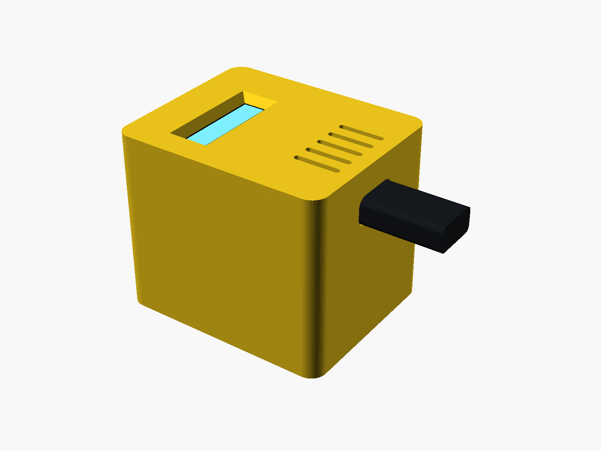

# case-library

3D-printable cases for small electronics kits, written in OpenSCAD. Anyone can add a case through an issue or a pull request, the way the Arduino Library Manager takes new libraries.

- Every case has a `case.json` that says what it holds and how sure it is. The fields are defined in [`case.schema.json`](case.schema.json).
- CI checks every case on each PR, exports every printable part, and runs the case's fit check.
- [`index.json`](index.json) lists every case. Tools and galleries read that file.

## Cases

<!-- The table between these markers is written by `python3 tools/gallery.py --readme`. Do not edit it by hand. -->
<!-- cases:start -->
| id | holds | status | outer (mm) |
|---|---|---|---|
| [`dbk-pcb-photo-shell`](cases/dbk-pcb-photo-shell/) | Plantower PMS7003 envelope · Carrier PCB, lying along one side of the sensor · 0.91in OLED module on the carrier PCB | concept, **not printed yet** | 56 × 44 × 19.2 |
| [`dbk-pcb-prism-100`](cases/dbk-pcb-prism-100/) · 100 variants | Plantower PMS7003 envelope · Carrier PCB with XIAO ESP32C3, 0.91in OLED and USB-C, lying on the sensor | concept, **not printed yet** | 59 × 47 × 21.8 |
| [`dbk-pms7003-xiao-c3`](cases/dbk-pms7003-xiao-c3/) | Plantower PMS7003 · Seeed XIAO ESP32C3, pre-soldered headers · SSD1306 128x32 0.91in OLED module | cad-fit-checked, **not printed yet** | 56 × 46 × 47 |

Browse every case with its preview and downloads in [`gallery/index.html`](gallery/index.html).
<!-- cases:end -->



## Status ladder

```
concept  ──►  cad-fit-checked  ──►  printed  ──►  field-tested
drawn          fit check passes     a fit report     used for real
               against part models  issue says it    (e.g. a classroom)
                                    fitted
```

- **Part sizes from photos alone keep a case at `concept`.** CI enforces this.
- **A case moves up only with evidence**: a passing fit check, or a fit report issue from someone who printed it.

## Print a case

1. Open the case folder.
2. The ready STLs are in `stl/`. They are also attached to every CI run as the `stl` artifact.
3. To change a size, edit the `.scad` file and re-export:

```
tools/render.sh cases/<id>
```

This needs OpenSCAD 2026 (a dev snapshot, for `--backend=manifold`) and the libraries listed in the case's `case.json`, such as BOSL2.

## Add a case

There are two ways, as with Arduino libraries.

| You keep the case… | Do this |
|---|---|
| **in this repo** | Open a PR that adds `cases/<id>/` with `case.json`, the `.scad`, `stl/` and one preview PNG. |
| **in your own repo** | Put `case.json` at your repo root. Then open a PR that adds one line to [`registry.txt`](registry.txt), or use the **Add a case** issue form. CI clones your repo and validates it again every week. |

Before you open a PR, run:

```
python3 tools/validate.py --write    # checks every case, rewrites index.json
python3 tools/gallery.py --readme    # rewrites gallery/cases.js and the Cases table above
tools/render.sh cases/<id>           # every print part exports, the fit check passes
```

## Gallery

**Live: https://dustboy-kit.github.io/case-library/gallery/** (GitHub Pages, published from `main` by `.github/workflows/pages.yml`).

[`gallery/index.html`](gallery/index.html) shows one card per case: preview, status, size, the parts it holds, license, and links to the STLs, the `.scad` and the case's own 3D viewer. To see it locally:

```
python3 -m http.server -b 127.0.0.1 8000    # then open http://127.0.0.1:8000/gallery/
```

Opening the file straight from disk works too. The page is React components (written with htm, no JSX) with no build step; React loads from esm.sh and Tailwind from jsDelivr, at pinned versions. Pastel-coloured variants are listed first. Its data lives in `gallery/cases.js`, written by `tools/gallery.py` from `index.json`. CI fails when that file or the README table is stale.

Other issue forms:
- **Request a case**: you have hardware and need a case drawn.
- **Fit report**: you printed a case. Say whether it fitted. This is how a case reaches `printed`.

## Rules

- **Say where each size came from**: `datasheet`, `measured`, `typical` or `photo-estimate`.
- **Bump `version` when the geometry changes.**
- **No costs, prices, private hostnames or credentials** in any file. This repo is public.
- **Each case states its own license.** The tools in `tools/` are MIT.

See [CONTRIBUTING.md](CONTRIBUTING.md) for the review steps.
