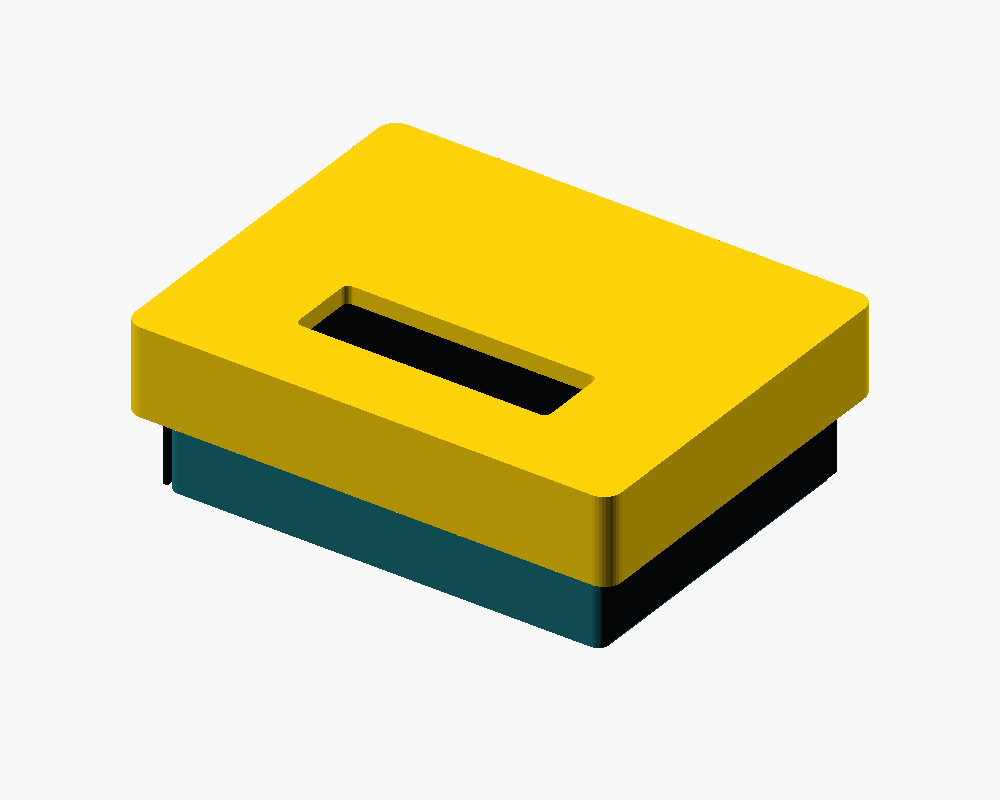

# dbk-pcb-photo-shell: photo-study shell for the carrier-PCB kit

A shallow cover that drops over the carrier PCB lying on top of the PMS7003, with a window for the OLED. Codex drew it from photos of the DustBoy Kit with the carrier board (Tong's ESP32minipms7003). Status: **concept**.

- **Every size is estimated from photos.** That includes the sensor envelope 50 × 38 × 12 (the datasheet says 48 × 37 × 12), the PCB 48 × 20 × 1.6 and the OLED 34 × 10.5 × 2.2. Nothing is measured or fit-checked.
- **Only the shell prints.** `stl/pm25-shell.stl` (56 × 44 × 10 mm); the sensor's underside stays open.
- **Why it is flat (about 19 mm closed):** the board lies directly on the sensor, with no wires or Dupont plugs. The breadboard-edition case [`dbk-pms7003-xiao-c3`](../dbk-pms7003-xiao-c3/) is taller because it leaves room for plugs.
- The carrier-PCB edition was dropped on 2026-11-19 in favour of the breadboard edition. This design is kept as a reference.

| File | What |
|---|---|
| `pm25-monitor.scad` | The model. Scenes: exploded, layout, stack, fit, pcb, sensor, shell, closed |
| `stl/pm25-shell.stl` | The printable shell |
| `renders/` | Ten views; `render.sh` re-renders them |
| `index.html` | The original view page |
