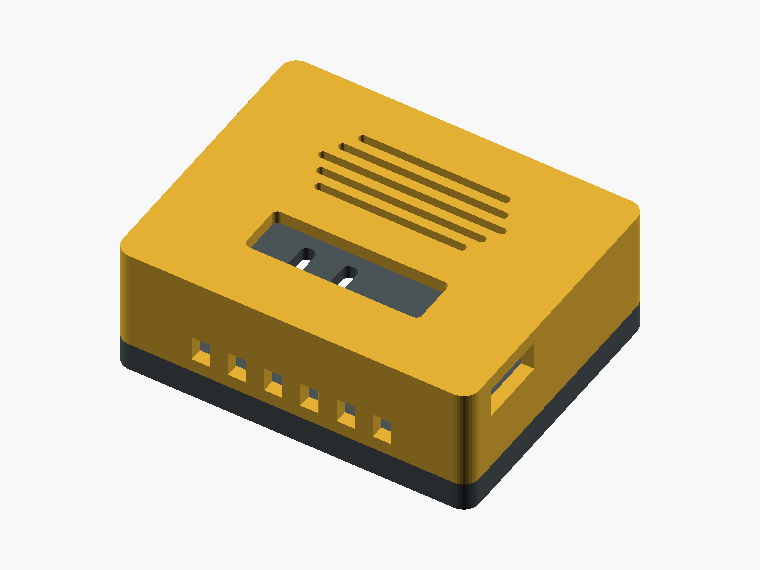

# dbk-pcb-prism-100: 100 prism enclosures for the carrier-PCB kit

One OpenSCAD file, 100 two-piece shells: ten body shapes × ten grille patterns. Each plate STL holds a lid and a base laid flat side by side. Codex drew it from photos of the DustBoy Kit with the carrier board (Tong's ESP32minipms7003). Status: **concept**.



- **Every size is estimated from photos.** That includes the sensor envelope 50 × 38 × 12 and the OLED aperture 29 × 8.5. Fit, fastening, USB clearance and airflow are untested.
- **Why it is flat (about 22 mm):** the board lies directly on the sensor, with no wires or Dupont plugs. The breadboard-edition case [`dbk-pms7003-xiao-c3`](../dbk-pms7003-xiao-c3/) is taller because it leaves room for plugs.
- **Pick a variant** in the gallery, or `plates/NNN.stl`. Variant ids follow `manifest.json`: the tens digit picks the body (Datum, Pebble, Bumper, Thumb, Loop, Bracket, Rib, Facet, Scallop, Keystone), the units digit picks the grille.
- **Edit one:**

```
openscad -D 'case_id=54' -D 'part="plate"' --export-format binstl -o bracket-honeycomb.stl cases.scad
```

- **Rebuild all 100:** `python3 build.py` (OpenSCAD 2026.10.11) regenerates `plates/`, `views/` and `manifest.json`. It also checks every mesh for open edges and for bodies that do not rest on the bed.
- `cases.scad` has one change from the original: a `scene` variable that overrides `part`, so `tools/render.sh` can export it like every other case.

| File | What |
|---|---|
| `cases.scad` | The model: `case_id` 1-100, `part` assembled / exploded / plate / lid / base |
| `plates/NNN.stl`, `views/NNN.png` | The 100 printable plates and their previews |
| `manifest.json` | Body, grille, triangle count, volume and geometry hash per variant |
| `PRISM.md` | The five design lenses behind the set |
| `README.source.md` | The original print notes |
