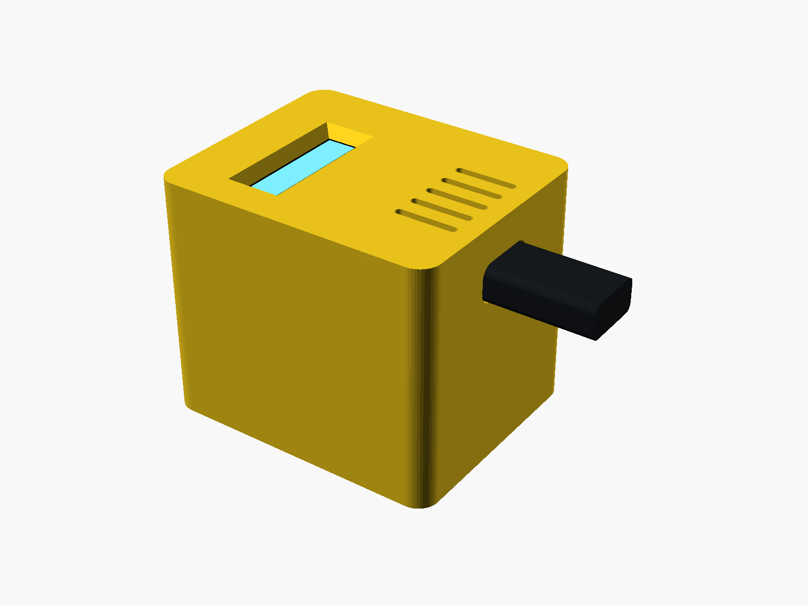
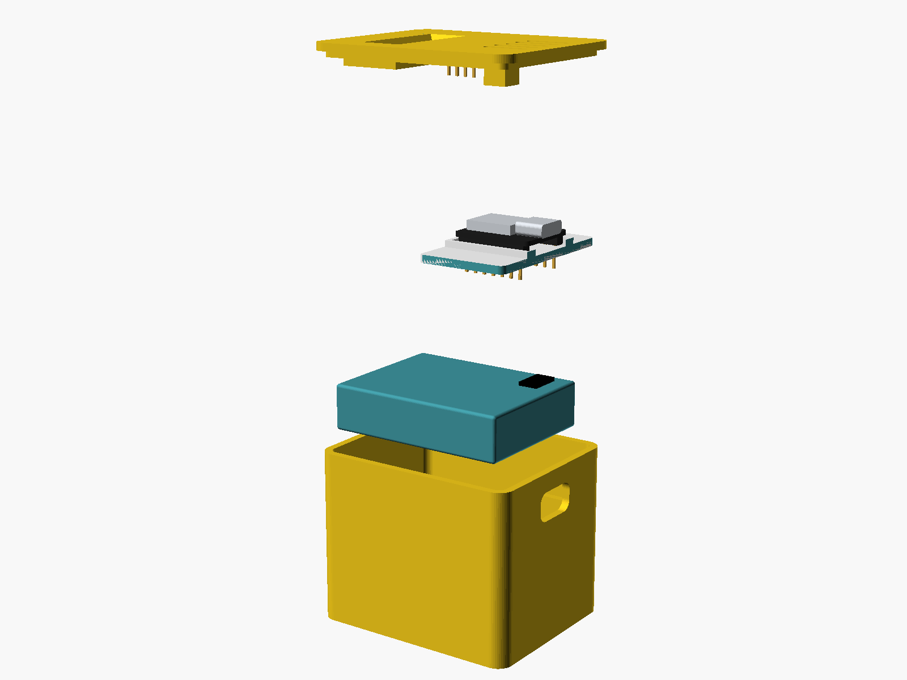

# dbk-pms7003-xiao-c3: DustBoy Kit case

This case holds the DustBoy Kit breadboard edition: a Plantower PMS7003, a Seeed XIAO ESP32C3 with pre-soldered headers, and a 0.91" SSD1306 128×32 OLED. It is three printed parts with no screws. Outside size: 56 × 46 × 47 mm.

## Parts

- **tub**: the PMS7003 lies on the floor with its air face 0.3 mm from the +X wall.
  - The inlet and outlet windows are larger than the sensor's ports.
  - An outside fin sits between them so outlet air is not drawn back into the inlet.
  - The USB-C opening is on the −X wall.
- **tray**: drops onto two ledges after the sensor is in.
  - The XIAO sits on its header plastic, and its pins go down through two slots, so Dupont plugs fit from below.
  - About 15 mm of wire space is left above the PMS7003.
- **lid**: the OLED sits in a pocket with its glass against the underside. The window is the active area plus 1 mm, chamfered.
  - A hold-down post presses on the XIAO's shield.
  - The lid lip is 1.6 mm deep with 0.25 mm clearance.

## Before you print

- **Measure your parts.** Values marked `MEASURE` in `dbk-case.scad` are typical module sizes, not datasheet sizes: the XIAO PCB thickness and shield, the USB-C overhang, and the OLED PCB and glass. Check them with calipers.
- **Fit check:** `fitcheck.sh` tests 15 pairs of bodies for overlap (last run: `fitcheck.txt`, every pair 0 mm³). It only checks against the part models; nothing has been printed yet. Please send a **Fit report** issue after you print it.
- **Software:** you need OpenSCAD 2026 (Manifold) and BOSL2 (built with `1351a9f`, 2026-11-17).
- **Viewer:** to turn the model in 3D, serve this folder (`python3 -m http.server 8978 --bind 127.0.0.1`) and open `index.html`.

| File | What |
|---|---|
| `dbk-case.scad` | The model. Scenes: assembled, exploded, section, lid_under, print, tub, tray, lid, fit_<a>_<b> |
| `stl/dbk-case-{tub,tray,lid}.stl` | The parts to print |
| `stl/ref/` | Models of the real parts, for the viewer and the fit check |
| `render.sh` | Re-renders `renders/*.png` and `stl/` |
| `fitcheck.sh`, `tools/stlvol.py` | The overlap check |
